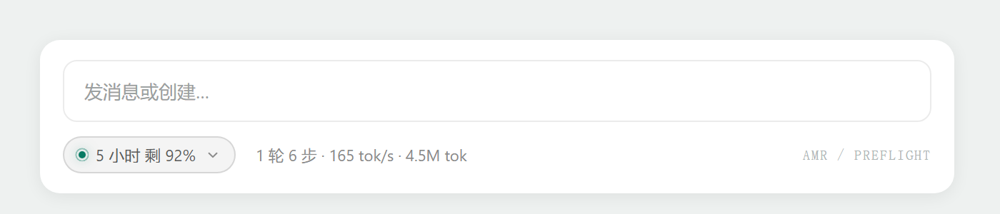
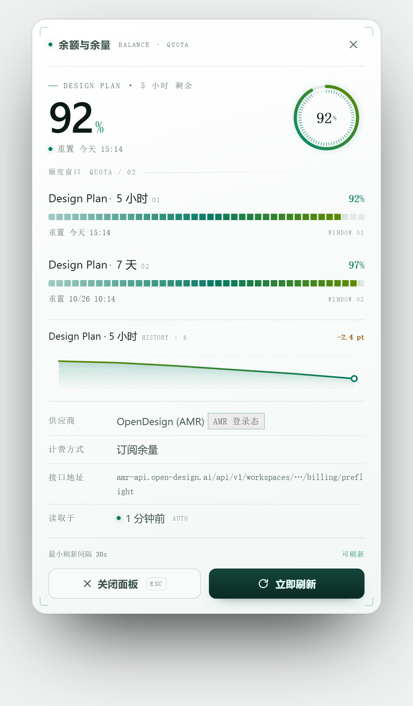

[中文](README.zh-CN.md) | **English**

# Balance & Quota · dsh-balance-meter

> A small plugin for DeepSeek Harness: **it tells you how much credit or quota is left for the model you're actually using.**

No control panels to open, no mental arithmetic, and no being fooled by a stale number — if it genuinely can't read your balance, it says why.



Click it to open the full panel:



---

## What problem it solves

Running an agent on API credit or a subscription, two things bite:

1. **You run out mid-task** and only find out when it breaks.
2. **You juggle several dashboards** — DeepSeek, Kimi, Zhipu — and they don't even report the same thing: some give money, some give percentages.

This plugin gathers it into one place: **whichever provider your current session is using, it reads that provider's balance** and shows it the same way every time.

---

## What it can read

Balances are **per provider**, not per model — every model under one provider shares the same pool.

### ✅ Supported: 9 built-in providers

| Provider | What it reads | Shown as |
|---|---|---|
| **DeepSeek** | account balance | money (`¥12.34`) |
| **OpenRouter** | key credit | money |
| **Moonshot / Kimi** | account balance | money |
| **SiliconFlow** | account balance | money |
| **智谱 GLM / Z.AI** | subscription quota | window percentages |
| **Kimi Coding** | subscription quota | window percentages |
| **MiniMax** | plan quota | window percentages |
| **OpenCode Go** | subscription quota | window percentages |
| **OpenDesign (AMR)** | wallet + Design Plan windows | money + percentages |

"Window percentages" means the plugin lists each quota period separately — rolling / weekly / monthly — with its own bar and reset time. So you can tell whether the 5-hour window is nearly spent or the monthly total is running out.

### ⚠️ May work: common relay panels

If you use a **self-hosted relay** (New-API, Sub2API, CloseAI, claude-code-hub and similar), the plugin tries a set of conventional endpoints in order:

```
/api/usage/token/  →  /v1/dashboard/billing/subscription  →  /v1/usage
→  /api/v1/me/quota  →  /dashboard/billing/credit_grants
→  /api/v1/credits  →  /api/user/self
```

Whichever returns a readable figure first wins. **An endpoint you configure yourself is tried before all of them.**

> The mechanism (ordering, short-circuiting, unit calibration) is covered by tests, but **each preset's response shape was transcribed from public panel documentation and the author cannot verify them all against live servers**. So an unrecognised shape is reported as "reachable but unparseable" with the raw response attached — never guessed at.

### ❌ Not supported

| Situation | What happens |
|---|---|
| **The vendor has no public balance endpoint** | Says so plainly; invents nothing |
| **Route isn't in the catalog and no preset matched** | Reports "not catalogued" plus the last raw response |
| **No credential configured** | Names the variable you need to set |
| **Endpoint answered but the shape is unknown** | Reports "unparseable" with an excerpt (secrets masked) |

"Not catalogued" means **this plugin doesn't recognise that provider yet** — it does not mean the vendor has no balance endpoint. Setting a custom endpoint via `balance_set_endpoint` usually fixes it.

---

## Install

```sh
dsh plugin --profile desktop add @zhujiuyi/dsh-balance
```

Then **restart DSH**. The readout appears on the stats row under the composer.

> Don't install `dsh-balance-meter` (no scope). That name belongs to an unrelated package on npm.

Prefer not to use npm? Install the tarball from a release instead — `/latest/` follows the newest one, so this command needs no editing:

```sh
dsh plugin --profile desktop add https://github.com/zhujiuyi/dsh-balance-meter/releases/latest/download/zhujiuyi-dsh-balance-0.2.5.tgz
```

Installing from the repository works too:

```sh
dsh plugin --profile desktop add github:zhujiuyi/dsh-balance-meter
```

Uninstall:

```sh
dsh plugin --profile desktop remove @zhujiuyi/dsh-balance
```

---

## Using it

Mostly you don't do anything. Three ways in:

1. **Glance** — the readout is always on the stats row: money for API credit, a percentage for subscriptions.
2. **Click** — provider, billing mode, endpoint, last-read time, and every quota window with its own bar.
3. **Ask** — say "how much quota is left" and the agent calls the `balance_check` tool.

---

## On getting the number right

This is what the plugin cares about most. Three rules:

**1. It never guesses.** If it can't read a figure it says so and explains why. "Unavailable" beats a plausible-looking wrong number.

**2. Stale figures are labelled.** If a refresh fails after a previous success, the readout keeps showing the last known value marked "possibly stale", with the failure reason in the details. An old number is never passed off as current.

**3. The trend chart uses real readings only.** That curve comes from reads that actually happened, not a hardcoded sample series. With fewer than two readings it says it's still collecting rather than drawing a fake history.

### When it refreshes automatically

- **After each finished turn** — refreshed once
- **A background check every 15 seconds** — refreshes if policy allows
- **A reading older than 5 minutes** — forced refresh (configurable)
- **You click "Refresh now"** — always

Two limits keep it polite: a **minimum interval** (30s by default) and a **failure cooldown**. Nothing polls while the page is hidden.

---

## OpenDesign users: one extra step

OpenDesign is the only provider whose **billing is not on the API gateway host**, and it needs a login first:

```sh
vela login          # or sign in through the OpenDesign desktop app
```

That writes a credential to `~/.amr/config.json`, which the plugin reads.

**Why this is required:** the `sk-amr-…` API key you configure in DSH is a *runtime* key for inference, and the vendor explicitly rejects it for billing reads. Balance can only be read with the control key that signing in produces.

Signed out, the plugin tells you to run `vela login` — it never treats that gateway as an uncatalogued relay and starts probing it.

---

## Configuration

Plugins page → the `@zhujiuyi/dsh-balance` card: preferred route, auto-refresh on/off, minimum interval, and the refresh-after ceiling.

To pin a custom endpoint or credential variable for one route, edit the `balance-meter` row in your profile's `cordis.patch.yml`:

```yaml
- id: balance-meter
  name: "@zhujiuyi/dsh-balance"
  config:
    primary: deepseek
    routes:
      - id: my-provider
        baseURL: https://api.example.com/v1
        apiKeyEnv: MY_PROVIDER_API_KEY
        endpoint: '{origin}/v1/balance'
```

Templates support `{origin}` (scheme + host) and `{base}` (the full baseURL). Prefer `{origin}` — it doesn't care whether your baseURL carries a path segment.

---

## Privacy

- **No `exec` permission, no subprocesses** — no shell, no curl.
- **Requests go only to the gateway you configured** — no third-party domains, no telemetry, no phone-home.
- **Keys are used for that gateway only** — read from DSH's credential store, put in a request header, never written to disk, logs, or the browser snapshot. The snapshot carries variable *names* only (there's a test asserting this).
- **Nothing else in DSH is modified** — only this plugin's own config row.

---

## For developers

```sh
npm run verify   # static contract check + all tests
npm test         # 305 tests, no DSH install required
npm run check    # contract check only
```

Four layers, none needing DSH: pure logic (parsers, preset chain, cache/throttle), host integration (stubs for `@deepseek-ai/*`, running the real `apply()`), a static contract check, and **browser-half render tests** (real `client.js` loaded with a minimal React stub and rendered across its states).

That last layer earns its keep: a `useMemo` referencing a `const` declared below it is a runtime scope error — invisible to `node --check` and to the contract check, but it crashes the component and makes the readout disappear. That happened once.

### Verification status

Of the 9 providers, **only OpenCode Go and OpenDesign have been checked against real responses** and had their parsers corrected. The rest report "reachable but unparseable" with an excerpt if their shape differs from the docs — send that excerpt and it gets fixed.

### Differences from the reference implementation

This is the DSH port of [ccgui-plugin-balance-meter](https://github.com/zhujiuyi/ccgui-plugin-balance-meter) (a CC GUI plugin). Because DSH provides credentials and outbound HTTP natively, this version **needs no exec permission**:

| | CC GUI version | This plugin |
|---|---|---|
| Reading credentials | Parses each engine's config, needs `exec:curl` | `ctx.credentials` directly |
| Networking | Host requires pre-declared domains, hence `exec:curl` | Plain `fetch` in-process |
| Route detection | Sniffs gateway hostnames | `ctx.llm.listProviders()` + profile |

Also: the readout sits on the composer stats row (`conversation.composer.dock`) rather than a status bar, and it lists **every readable window side by side** (5-hour · weekly · monthly) — a plan stops you on whichever window is exhausted first, not on the shortest one. On the chip the 5-hour label is green, the weekly label blue, a 0%-remaining label turns red, and the numbers stay white.

Design spec: [docs/superpowers/specs/2026-10-14-dsh-balance-meter-design.md](docs/superpowers/specs/2026-10-14-dsh-balance-meter-design.md).

---

## License

MIT
